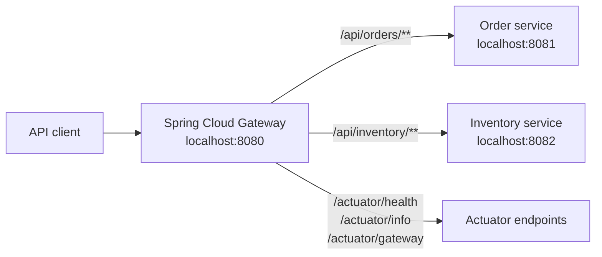
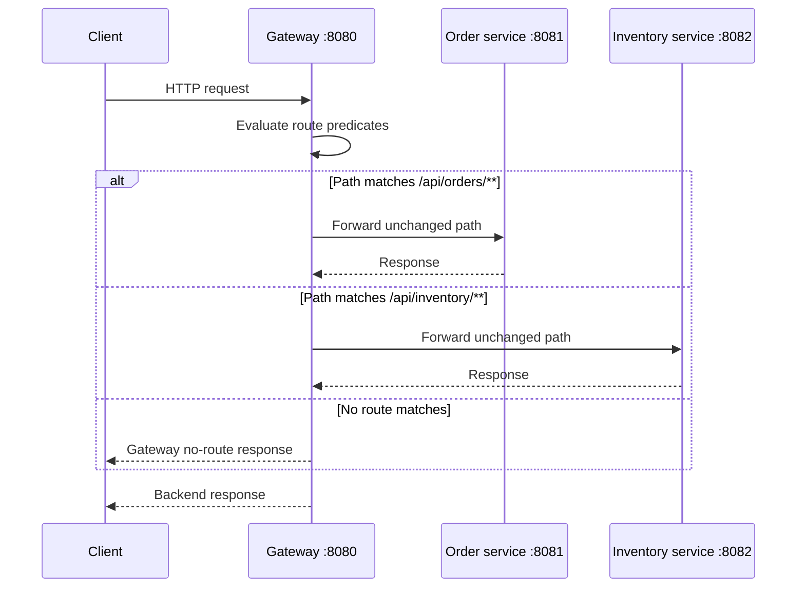

# Spring API Gateway

This project is a lightweight API gateway built with Spring Boot and Spring
Cloud Gateway. It is the single HTTP entry point for the services configured in
`src/main/resources/application.yml`.

The gateway currently performs path-based routing:

| Public path | Backend service | Backend address |
| --- | --- | --- |
| `/api/orders/**` | Order service | `http://localhost:8081` |
| `/api/inventory/**` | Inventory service | `http://localhost:8082` |

For example, a request to `http://localhost:8080/api/orders/42` is forwarded to
the order service at `http://localhost:8081/api/orders/42`. The configured
`Path` predicates match the request path, and the path is preserved because no
rewrite filter is configured.

## Why use an API gateway?

An API gateway gives clients one stable endpoint while backend services remain
independently deployable. It is a useful place to centralize cross-cutting
concerns such as:

- routing and service boundary protection;
- authentication and authorization;
- rate limiting and request quotas;
- CORS policy;
- correlation IDs and access logging;
- retries, timeouts, circuit breakers, and fallbacks;
- TLS termination and API versioning.

This sample currently implements routing and basic operational endpoints only.
Authentication, rate limiting, resilience policies, request transformation,
service discovery, and load balancing are not configured yet.

## Architecture



The gateway is a reactive application supplied by Spring Cloud Gateway. The
`ApiGatewayApplication` class only starts Spring Boot; route definitions are
loaded from YAML by auto-configuration.

## Request flow



For a matching route, the gateway selects the route whose predicate succeeds,
creates a downstream request using the configured URI, and returns the
downstream response to the client. With the current configuration, a request
that matches neither path has no application route and is not sent to either
backend.

## Project structure

```text
.
├── pom.xml
├── src/main/java/com/example/gateway/ApiGatewayApplication.java
└── src/main/resources/application.yml
```

### `ApiGatewayApplication`

This is the Spring Boot entry point. `@SpringBootApplication` enables component
scanning and auto-configuration, and `SpringApplication.run(...)` starts the
gateway server.

There are no Java route beans in this project. The routes are declarative and
are defined in `application.yml`.

## `application.yml` properties

The following is the current configuration, explained section by section.

### Server

```yaml
server:
  port: 8080
```

| Property | Meaning | Current use |
| --- | --- | --- |
| `server.port` | TCP port used by the embedded server | The gateway listens on port `8080` |

Clients should call the gateway on this port. The backend services use ports
`8081` and `8082` in their route URIs and must be running separately.

### Spring application identity

```yaml
spring:
  application:
    name: api-gateway
```

| Property | Meaning | Current use |
| --- | --- | --- |
| `spring.application.name` | Logical application name used in logs, metrics, tracing, and service-discovery integrations | Identifies this application as `api-gateway` |

This name does not change the listening port or URL. It becomes more important
when the application is connected to a registry, centralized configuration,
metrics system, or distributed tracing platform.

### Gateway routes

```yaml
spring:
  cloud:
    gateway:
      routes:
        - id: order-service
          uri: http://localhost:8081
          predicates:
            - Path=/api/orders/**
        - id: inventory-service
          uri: http://localhost:8082
          predicates:
            - Path=/api/inventory/**
```

| Property | Meaning | Current use |
| --- | --- | --- |
| `spring.cloud.gateway.routes` | Collection of route definitions | Contains the order and inventory routes |
| `routes[].id` | Unique identifier for a route | `order-service` and `inventory-service` |
| `routes[].uri` | Downstream destination used when the route matches | `http://localhost:8081` or `http://localhost:8082` |
| `routes[].predicates` | Conditions that must match before forwarding | Each route uses one `Path` predicate |
| `Path=/api/orders/**` | Matches `/api/orders/` and paths below it | Sends requests to port `8081` |
| `Path=/api/inventory/**` | Matches `/api/inventory/` and paths below it | Sends requests to port `8082` |

The `**` wildcard matches the remaining path. No `RewritePath`, `StripPrefix`,
`AddRequestHeader`, `Retry`, `CircuitBreaker`, or authentication filter is
present, so the gateway does not transform or otherwise enrich these requests.

The URIs use fixed localhost addresses, which is convenient for local
development. In a deployed environment, replace them with service DNS names,
container names, Kubernetes services, or discovery-based `lb://` destinations.

### Actuator endpoint exposure

```yaml
management:
  endpoints:
    web:
      exposure:
        include: health,info,gateway
```

| Property | Meaning | Current use |
| --- | --- | --- |
| `management.endpoints.web.exposure.include` | Selects Actuator endpoints available over HTTP | Exposes `health`, `info`, and `gateway` |
| `health` | Health information for readiness/liveness checks | Available at `/actuator/health` |
| `info` | Application information | Available at `/actuator/info` |
| `gateway` | Gateway route and predicate inspection | Available at `/actuator/gateway` |

These endpoints are served below `/actuator` by default. The current YAML does
not configure authentication, a management port, or endpoint detail levels.
Do not expose the gateway inspection endpoint publicly without protecting it.

## Local setup

### Prerequisites

- Java 17 or newer;
- Maven 3.9 or newer, or an IDE with Maven support;
- an order service listening on `localhost:8081`;
- an inventory service listening on `localhost:8082`.

### Start the gateway

```bash
mvn spring-boot:run
```

Or build and run the packaged application:

```bash
mvn clean package
java -jar target/api-gateway-1.0.0.jar
```

### Try the routes

```bash
curl http://localhost:8080/api/orders/42
curl http://localhost:8080/api/inventory/sku-100
curl http://localhost:8080/actuator/health
curl http://localhost:8080/actuator/gateway/routes
```

The first two commands require the corresponding backend services to be
running. The gateway itself does not provide order or inventory data.

## Operational behavior and failure cases

- If a backend is unavailable, the gateway cannot complete the forwarded
  request and the client receives a downstream connection or gateway error.
- A path outside the two configured patterns does not match a route.
- The gateway currently has no timeout, retry, circuit breaker, fallback, or
  load-balancing policy configured.
- The route URI does not include a path suffix, so the original request path
  is forwarded to the backend.
- Query parameters are part of the forwarded request unless another filter or
  application policy changes them.

## Recommended next steps for production

1. Move backend URLs to environment-specific configuration, for example
   `${ORDER_SERVICE_URL}` and `${INVENTORY_SERVICE_URL}`.
2. Protect Actuator endpoints and expose only the health endpoints needed by
   the platform.
3. Add authentication and authorization at the gateway or delegate them to a
   trusted identity-aware layer.
4. Add request timeouts, circuit breakers, retries only where safe, and a
   consistent error response format.
5. Add structured access logs, correlation IDs, metrics, and distributed
   tracing.
6. Use service discovery or a platform service name instead of fixed
   `localhost` addresses when services run in separate containers or hosts.
7. Add integration tests that verify route matching, backend failures, and
   actuator exposure.

## Technology versions

The Maven build currently uses:

- Spring Boot `3.3.5`;
- Spring Cloud `2023.0.3`;
- Java `17`;
- Spring Cloud Gateway;
- Spring Boot Actuator.

